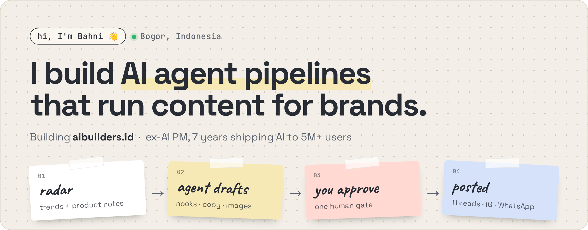
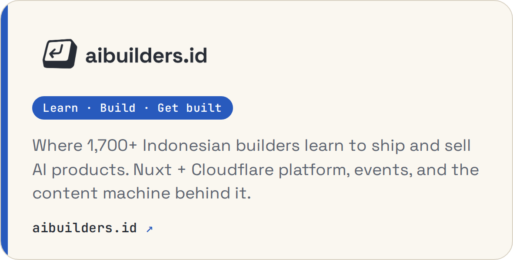
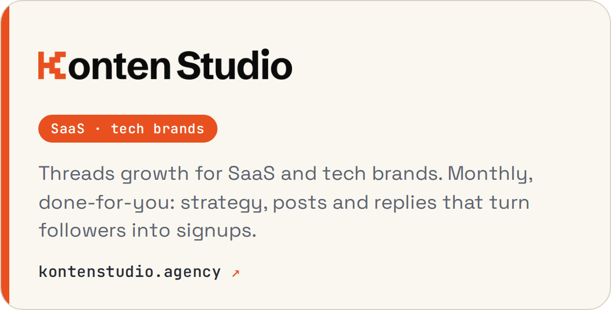
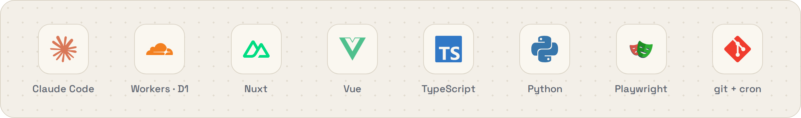
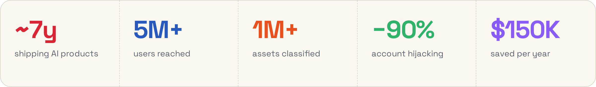

  <picture><source media="(prefers-color-scheme: dark)" srcset="assets/hero-dark.png"></picture>

### 🛠️ What I'm building

Most of my days go into the machine behind my brands: agent pipelines that pick up
trends and product notes, draft hooks, copy and images, wait for one human approval,
then post to Threads, IG and WhatsApp on schedule.

  <a href="https://aibuilders.id"><picture><source media="(prefers-color-scheme: dark)" srcset="assets/card-aibuilders-dark.png"></picture></a>
  <a href="https://kontenstudio.agency"><picture><source media="(prefers-color-scheme: dark)" srcset="assets/card-kontenstudio-dark.png"></picture></a>

### 🧰 Open tools for agent users

| | Repo | What it does |
|:-:|---|---|
| 📣 | **[bipit](https://github.com/konten-studio/bipit)** | Turn your agent session into a build-in-public post |
| ✍️ | **[jekardah-writer](https://github.com/konten-studio/jekardah-writer)** | Hooks, anti-slop editing and a natural Jakarta voice |
| 📖 | **[code-with-quran](https://github.com/bahni-m/code-with-quran)** | Read the Qur'an, one ayah per prompt, while Claude Code works |
| 📝 | **[prd-prompt-collection](https://github.com/ai-builders-id/prd-prompt-collection)** | PRD prompts that turn a spec into a working frontend prototype |
| 🧑‍💼 | [marshal](https://github.com/peakspec/marshal) | A multi-agent PM-ops team for Claude Code |

### ⚡ Stack I live in

  <picture><source media="(prefers-color-scheme: dark)" srcset="assets/stack-dark.png"></picture>

### 📈 Before this

~7 years as an AI product leader across Enterprise, MarTech, GovTech, Travel and Mobility.

  <picture><source media="(prefers-color-scheme: dark)" srcset="assets/stats-dark.png"></picture>

  
  
  
  

