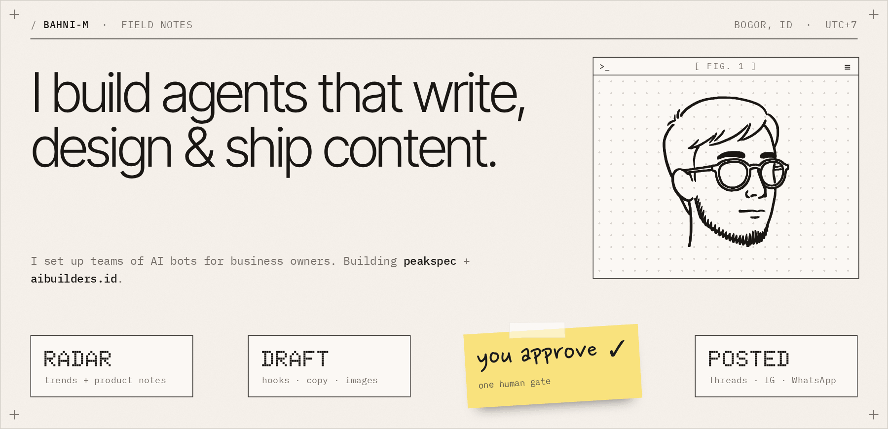
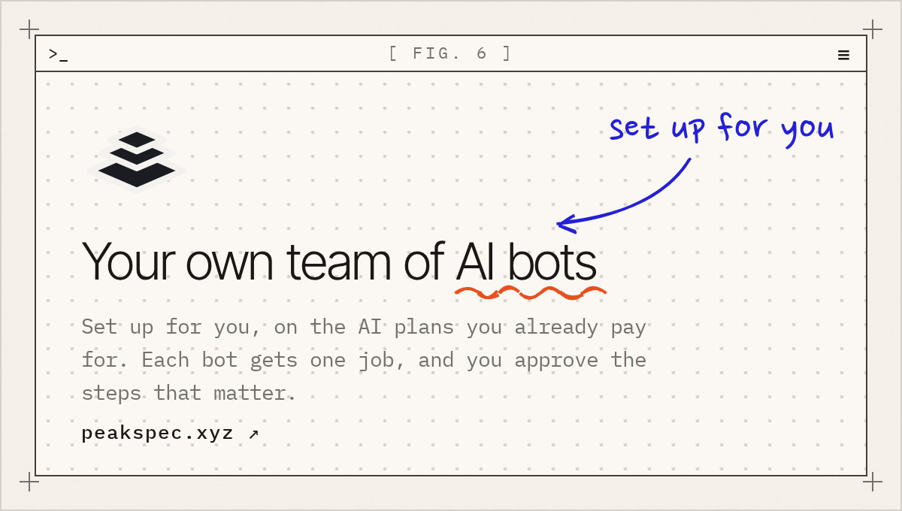
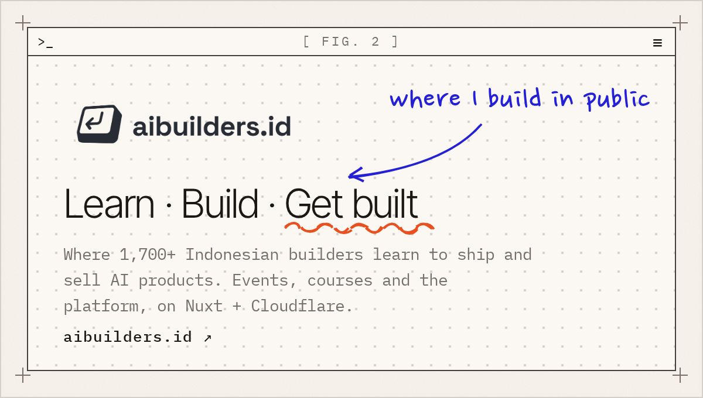
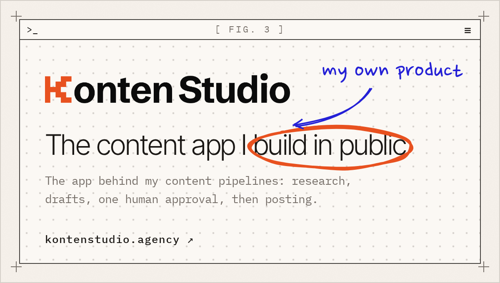
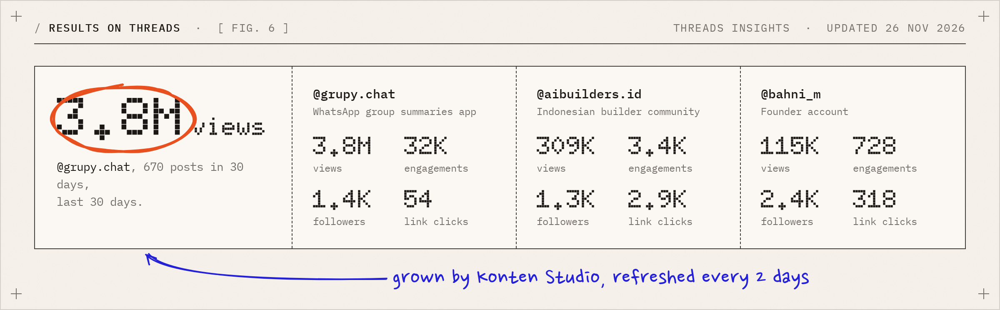
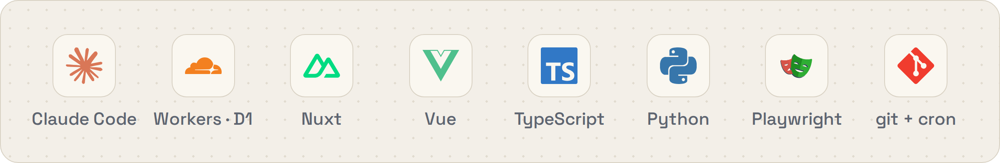
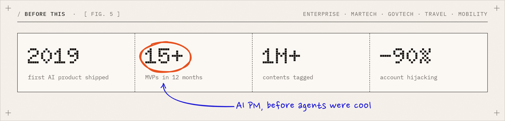

  <picture><source media="(prefers-color-scheme: dark)" srcset="assets/hero-dark.gif"></picture>

### / what I'm building

Most of my days go into two things: setting up teams of AI bots for business owners,
and the machine behind my own brands. Each bot gets one job.

  <a href="https://peakspec.xyz/?utm_source=github&amp;utm_medium=readme&amp;utm_campaign=peakspec-v2&amp;utm_content=peakspec-card#book"><picture><source media="(prefers-color-scheme: dark)" srcset="assets/card-peakspec-dark.png"></picture></a>
  <a href="https://aibuilders.id"><picture><source media="(prefers-color-scheme: dark)" srcset="assets/card-aibuilders-dark.png"></picture></a>
  <a href="https://kontenstudio.agency"><picture><source media="(prefers-color-scheme: dark)" srcset="assets/card-kontenstudio-dark.png"></picture></a>

### / my team

aibuilders.id runs on me plus 9 AI agents. Each one has one job: research and copy, content and visuals, sales, the numbers, ops. Every morning they report in and their work gets reviewed.

It's the setup I build for business owners at peakspec.xyz, with the same rule: I approve the steps that matter.

### / results on threads

The brands my pipelines run, straight from Threads Insights. Refreshed every 2 days, same numbers as [kontenstudio.agency](https://kontenstudio.agency).

  <a href="https://kontenstudio.agency"><picture><source media="(prefers-color-scheme: dark)" srcset="assets/results-dark.png"></picture></a>

### / open tools for agent users

| Repo | What it does |
|---|---|
| **[marshal](https://github.com/peakspec/marshal)** | A multi-agent PM-ops team for Claude Code |
| **[code-with-quran](https://github.com/bahni-m/code-with-quran)** | Read the Qur'an, one ayah per prompt, while Claude Code works |
| **[prd-prompt-collection](https://github.com/ai-builders-id/prd-prompt-collection)** | PRD prompts that turn a spec into a working frontend prototype |

### / stack

  <picture><source media="(prefers-color-scheme: dark)" srcset="assets/stack-dark.png"></picture>

### / before this

Before agents, I led AI products across mobility, travel, govtech, enterprise and martech.

  <picture><source media="(prefers-color-scheme: dark)" srcset="assets/stats-dark.png"></picture>

  
  
  
  
  
  

Images are rendered from HTML in <a href="src/">src/</a> (Playwright + rough.js). The avatar is an AI-drawn portrait of me.
